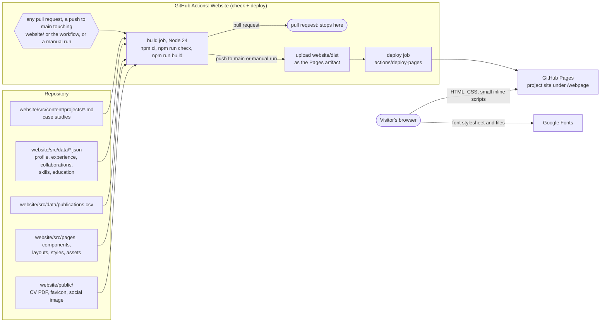

# Check, build and deploy

How the content files become the published site: Astro reads everything at build time, and the one GitHub Actions
workflow, `.github/workflows/deploy-website.yml`, checks every pull request and publishes `main` to GitHub Pages.

