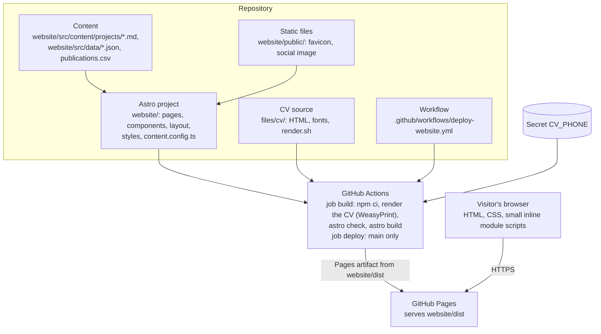

# Containers

The parts of the repository and where each one runs. There is one deployable, the Astro project in
`website/`; the CV is rendered from `files/cv/` by the build job, with the phone number from a secret.

| Container | Technology | Runs where | Doc |
|---|---|---|---|
| Astro project | Astro 5, TypeScript, plain CSS | at build time, in GitHub Actions or locally | [overview](../architecture/overview.md) |
| Content | Markdown, JSON, CSV checked by Zod schemas | read at build time | [data model](../reference/data-model.md) |
| Workflow | GitHub Actions, Node 24, WeasyPrint 69.0 | on every pull request; on a push to `main` that touches `website/`, `files/cv/` or the workflow; on a manual run | [build and deploy](build-and-deploy.md) |
| Published site | static HTML and CSS | GitHub Pages | [overview](../architecture/overview.md#context) |
| CV | HTML rendered to PDF with WeasyPrint, phone number from the `CV_PHONE` secret | in the build job; locally with `files/cv/render.sh` | [development](../guides/development.md#the-cv) |
