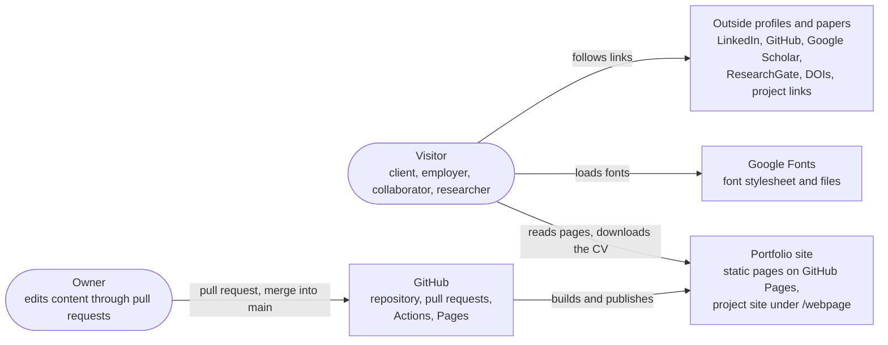

# Context

Who uses the site and what it touches outside itself. The site is static: after the deploy nothing of it runs
except the small scripts in the visitor's browser.

Nothing on the site sends data anywhere: there are no forms, no analytics and no requests from page scripts.
The email link opens the visitor's own mail client.
